# Galerie des exemples

Chaque script de ce dossier trace un diagramme avec `thermodiagrammes` et enregistre
sa figure dans le dossier d'où on le lance ; les images ci-dessous en sont les rendus,
dans l'ordre où on les découvre d'habitude : les diagrammes de l'eau, les diagrammes
simplifiés, un autre fluide, puis CoolProp sans habillage. Deux scripts (`pv_eau.py`
et `diagrammes_simplifies_eau.py`) composent leurs textes en LaTeX (`text.usetex`) et
demandent une distribution TeX.

## Les diagrammes de l'eau

### Diagramme (P, h) de l'eau avec toutes ses isolignes (`diagramme_ph_eau.py`)

Le diagramme des frigoristes de l'eau, du point triple au double de la pression
critique, avec le dôme de saturation et quatre familles d'isolignes : les isotitres en
tirets, les isothermes (orange), qui traversent le dôme par leur palier horizontal, les
isentropes (vert) et les isochores (rouge). Le script construit un
`PH("Water", unites=Unites(P="bar", H="MJ", T="celsius"), plim=(0.006, 450))`, laisse
`hlim` à sa valeur par défaut (le dôme et une marge), demande à `valeurs_auto_T`,
`valeurs_auto_x`, `valeurs_auto_s` et `valeurs_auto_v` des valeurs raisonnables pour le
fluide et les indices des courbes à étiqueter, puis trace avec `saturation` et
`trace_isos` ; `diagramme.fluide` donne les points critique et triple en SI. La figure
est enregistrée par `enregistre()` sous son nom par défaut,
`Diagramme_Ph_coolprop_Water.pdf`.

### Diagramme (P, h) de l'eau en kelvin, de 0,4 à 500 bar (`diagramme_ph_eau_kelvin.py`)

Le même diagramme en grand format (16 × 10 pouces), en kelvin, de 0 à 5000 kJ/kg et de
0,4 à 500 bar : on voit la zone vapeur loin du dôme, où les isothermes deviennent
verticales (pour un gaz parfait, h ne dépend que de T) et les isochores presque
droites. Les isothermes sont données à la main (`np.arange(300, 1500, 50)` K) et les
isochores une par une ; les isentropes viennent de `valeurs_auto_s`.
`Unites(T="kelvin")` change l'unité de température, `titre=""` supprime le titre, et
`enregistre("DiagrammeWater.png", dpi=200, transparent=True)` montre que `enregistre`
passe ses options à `savefig`. D'après J.-J. Fleck, modifié par Y. Alméras.

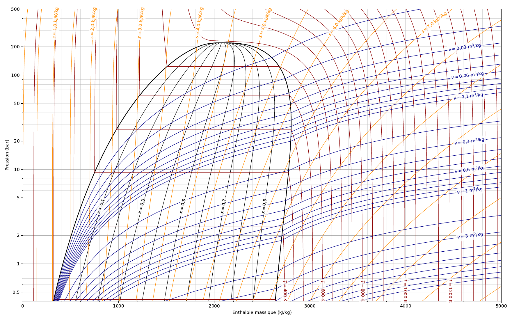

### Diagramme (T, s) de l'eau : isobares, isotitres, isenthalpes (`diagramme_ts_eau.py`)

Le diagramme entropique de l'eau de 0 à 440 °C : la cloche de saturation, les isobares
en tiret-point de 0,01 à 10 000 bar (palier horizontal dans le dôme, et dans le liquide
des isobares serrées le long de la courbe d'ébullition), les isotitres et dix
isenthalpes, horizontales dans la vapeur loin du dôme. `TS("Water", slim=(0, 10.1),
Tlim=(1, 440))`, puis `valeurs_auto_P(par_decade=(1, 2, 5))` filtré avec numpy et
`trace_isos("P", …, linestyle="-.")`, `trace_isos("Q", …)` et `trace_isos("H", …)` ;
`enregistre()` sans argument écrit `Diagramme_Ts_coolprop_Water.pdf`. D'après
J.-J. Fleck.

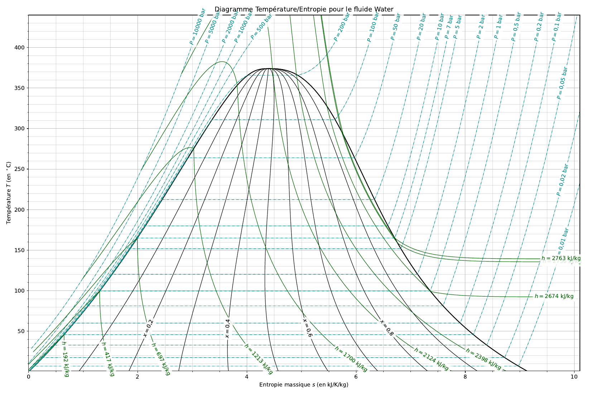

### Diagramme de Mollier (h, s) de l'eau (`mollier_eau.py`)

Le diagramme (h, s) autour de la courbe de rosée, de l'entropie du point critique à
11 kJ/K/kg : la courbe de saturation en noir, trois isotitres, trois isothermes (Tc,
2 Tc et 373 K), dont la partie vapeur devient horizontale loin du dôme, et trois
isobares (1 bar, Pc et 0,01 bar) ; une légende regroupe les familles. Le script part
d'un `Fluide("Water")`, qui parle en SI, et d'un
`Unites(P="bar", H="kJ", S="kJ", T="kelvin")` : `unites.depuis_si` convertit l'entropie
critique calculée par `f.S(T=f.Tcrit, D=f.rhocrit)`, `etat_critique().P` donne la
pression critique en bar, et `trace_isos(..., etiquettes=[])` rend les `Line2D`
auxquelles on donne un `label`. D'après C. Cayssiols.

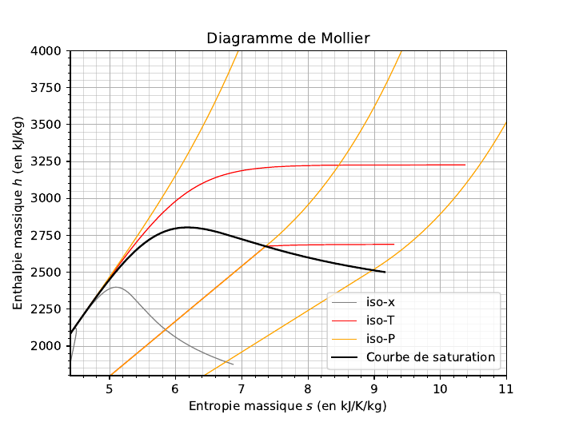

### Diagramme de Clapeyron (P, v) de l'eau (`clapeyron_eau.py`)

Le diagramme (P, v) en échelles logarithmiques, de 10⁻⁴ à 12 m³/kg et de 0,1 à
1000 bar : la courbe de saturation, les isothermes d'Andrews à 100 °C, Tc et 2 Tc
(palier dans le dôme, tangente horizontale au point critique, droites du gaz parfait
loin du dôme), trois isotitres, et les isenthalpes et isentropes passant par le liquide
saturant à 100 °C, par le liquide saturant à 10 bar et par le point critique.
`PV("Water", unites=Unites(P="bar", H="kJ", S="kJ", T="celsius"), vlim=…, plim=…)`,
`diagramme.fluide.Tcrit` (en kelvin) converti par `celsius`, `etat(T=100, Q=0)` et
`etat(P=10, Q=0)` pour obtenir h et s de deux états, `etat_critique()`, puis
`saturation` et `trace_isos` ; `enregistre("clapeyron_eau.pdf")`. D'après
C. Cayssiols.

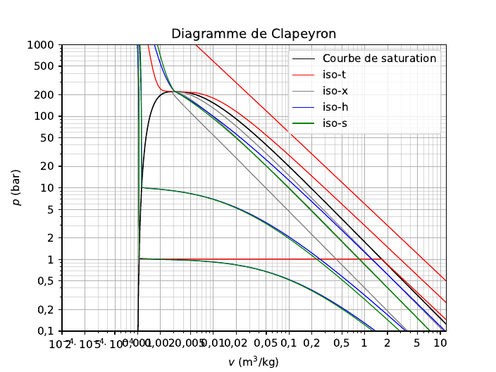

### Isothermes d'Andrews de l'eau (`pv_eau.py`)

Trois figures en LaTeX autour des isothermes d'Andrews. La première est le diagramme
« par défaut » : la fonction `isothermes_d_andrews` reçoit un nom de fluide, en fait un
`Fluide`, prend les isothermes du point triple à 1,2 Tc par pas de 20 K et une fenêtre
de v du liquide au point triple à dix fois la vapeur au point triple ; elle sert à
repérer la zone intéressante. Les deux suivantes resserrent la fenêtre (10 kPa à
50 MPa, 0,5 L/kg à 30 m³/kg, treize isothermes de 293 à 773 K), sans puis avec la
courbe de saturation : paliers de vaporisation de plus en plus courts jusqu'au point
critique, isothermes monotones au-dessus. `PV(f, unites=Unites(P="Pa", T="kelvin"), …)`,
`trace_isos("T", [Ti], etiquettes=[], label=…)` une isotherme à la fois pour la
légende, `saturation(linewidth=2)`, `enregistre(fichier, bbox_inches="tight",
pad_inches=0)`. D'après J.-J. Fleck.

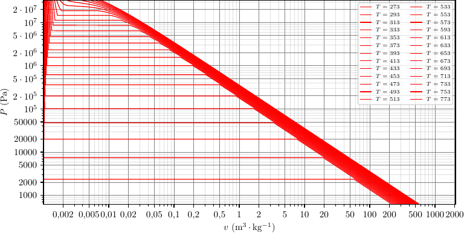

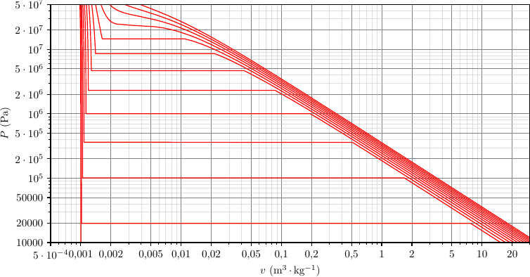

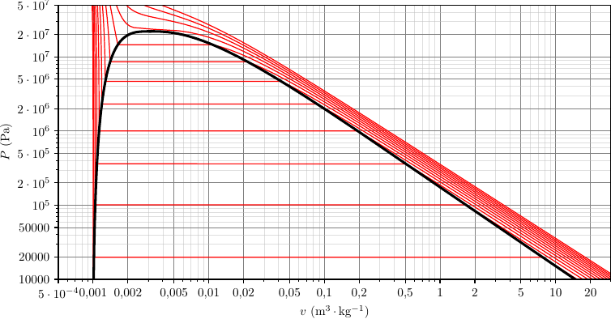

### Diagramme de phases (P, T) de l'eau (`diagramme_pt_eau.py`)

Le diagramme (P, T) de −60 à 700 °C et de 10⁻⁴ à 10⁴ bar : `saturation` trace la
courbe de vaporisation du point triple T au point critique C, la courbe de fusion (loi
de CoolProp, glaces I à VII, avec la pente négative de la glace I) et la courbe de
sublimation, que le paquet calcule par Clausius-Clapeyron depuis le point triple grâce
à `L_fusion=333.5` kJ/kg. Cinq isochores de 10⁻³ à 10 m³/kg montrent que la vapeur se
dilate et que le liquide ne bouge presque pas ; un chauffage isobare de A (25 °C) à B
(200 °C) sous 1 bar, tracé par `trace_chemin(depart, arrivee, "P")` entre deux
`coordonnees`, traverse la courbe de vaporisation. `etat(T=25, P=1)` donne v et s de
l'eau ambiante, `point_triple` et `point_critique` leurs coordonnées ; `ajoute_point`
et `ax.text` nomment les points et les domaines. D'après un exemple de la documentation
de CoolProp.

## Les diagrammes simplifiés

### Trois diagrammes simplifiés de l'eau (`diagrammes_simplifies_eau.py`)

Trois petites figures de 3 × 3 pouces en LaTeX, avec une seule famille d'isolignes
chacune pour rester lisibles à cette taille : (T, s) avec les isotitres de 0,1 à 0,9,
(P, h) avec les isothermes de 300 K à 1,8 Tc par pas de 50 K, (h, s) avec les isobares
1 et 3 × 10ⁿ bar entre 5 % de la pression triple et 1,1 fois la pression critique. Un
seul `Fluide("Water")`, en SI, et un seul `Unites(P="bar", H="kJ", S="J", T="kelvin")`
servent aux trois : `UNITES.depuis_si` convertit les limites calculées à partir de
`EAU.Ttriple`, `EAU.Tcrit`, `EAU.Ptriple`, `EAU.Pcrit`, `EAU.S(T=…, Q=…)` et
`EAU.H(P=…, Q=…)` ; `TS`, `PH` et `HS` partagent `cree`, `saturation`,
`trace_isos(..., style_etiquette={"fontsize": 6})` et
`enregistre(fichier, bbox_inches="tight", pad_inches=0)`. D'après J.-J. Fleck.

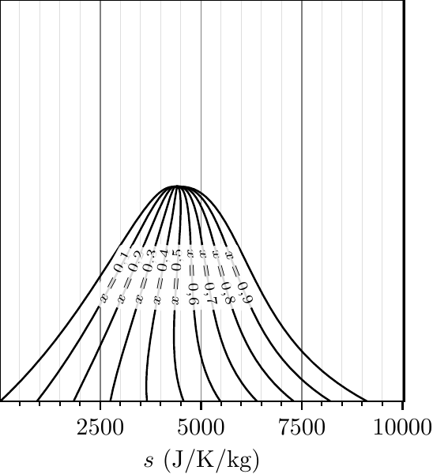

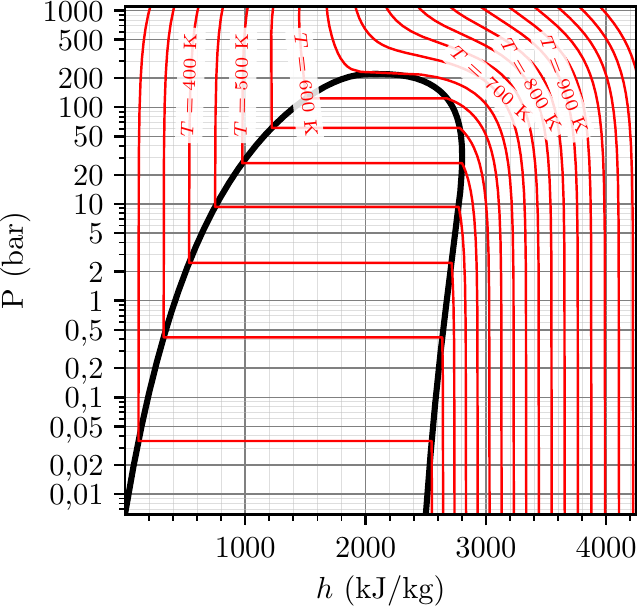

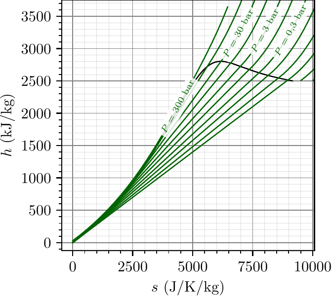

## Un autre fluide

### Diagramme (P, h) de l'azote, côté vapeur, avec deux points (`diagramme_ph_azote.py`)

Un fluide autre que l'eau, désigné par son alias frigoriste :
`PH("R728", label="R728 (azote)", hlim=(75, 400), plim=(1, 40))`, en bar, kJ/kg, °C et
kJ/K/kg. La fenêtre cadre la vapeur à droite de la courbe de rosée : les isothermes de
−180 à 60 °C, verticales à basse pression (gaz parfait) et incurvées près du dôme, les
isentropes de 2,5 à 7,4 kJ/K/kg étiquetées une sur quatre, et les isotitres ;
`ajoute_point(350, 20, "A")` et `ajoute_point(150, 4, "B")` posent deux états, par
exemple les extrémités d'une transformation. `etiquettes=range(2, len(val_T), 4)` et
`position` choisissent quelles courbes portent une étiquette et où. D'après
J.-J. Fleck.

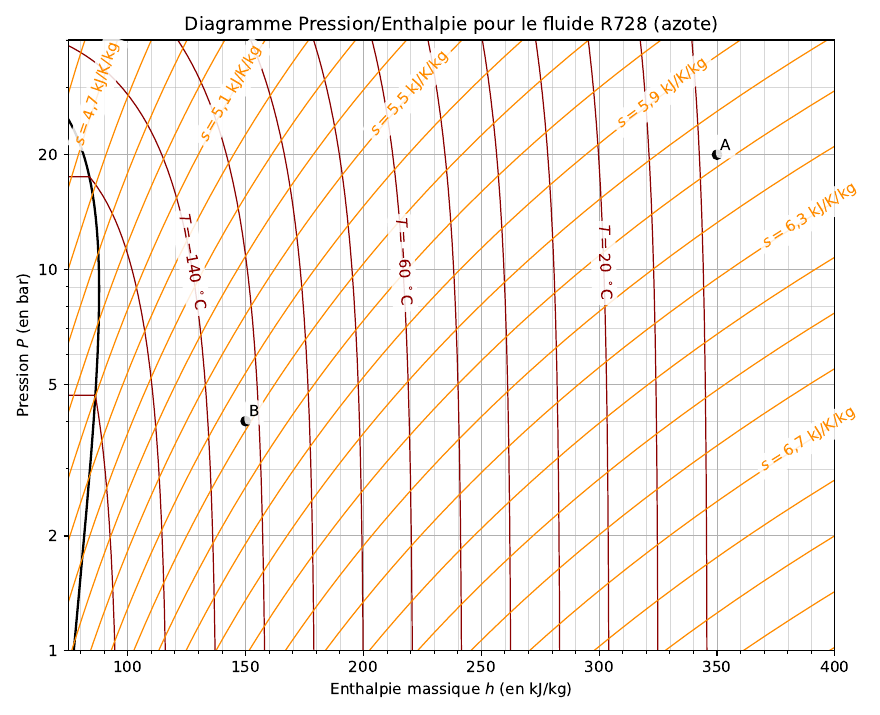

## CoolProp sans habillage

### Tour d'horizon de CoolProp (`coolprop_exemples.py`)

Un script sans `thermodiagrammes`, qui montre ce que CoolProp sait faire seul :
l'interface haut niveau `PropsSI` (température critique, ébullition sous 1 atm, phase,
capacité thermique, dérivée partielle), l'air humide avec `HAPropsSI`, les fluides
incompressibles et les saumures (`INCOMP::MEG-50%`, `INCOMP::TD12`), l'interface bas
niveau `AbstractState` (dérivée le long de la courbe de saturation du R245fa,
température de rosée d'un mélange eau-éthanol) et le volume massique comme inverse de
la masse volumique. Il se termine par le tracé de base de `CoolProp.Plots.PropertyPlot`,
un diagramme (P, h) de l'eau enregistré en PNG : des isolignes sans étiquettes, à
comparer aux figures ci-dessus. Généré à l'origine par le script d'exemples d'Ian Bell
(CoolProp).

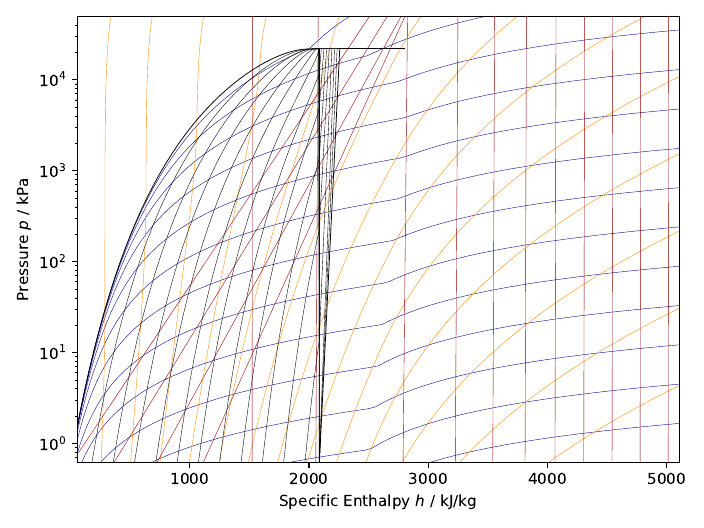
